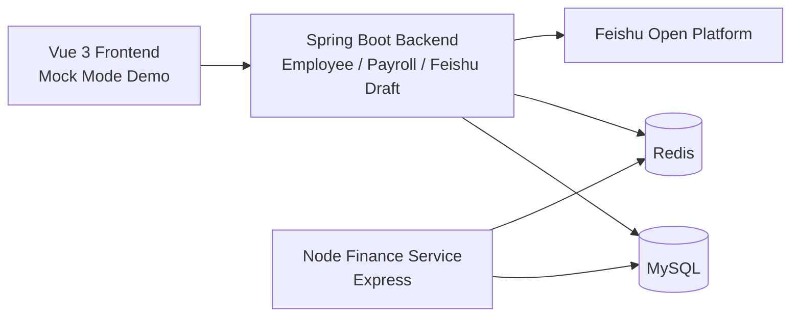
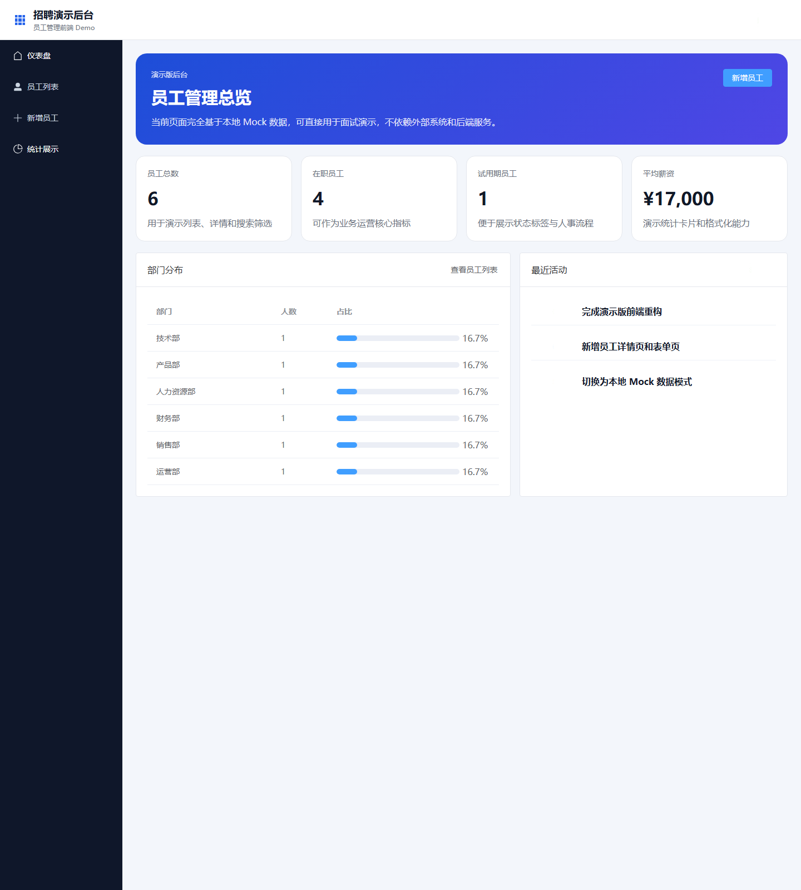
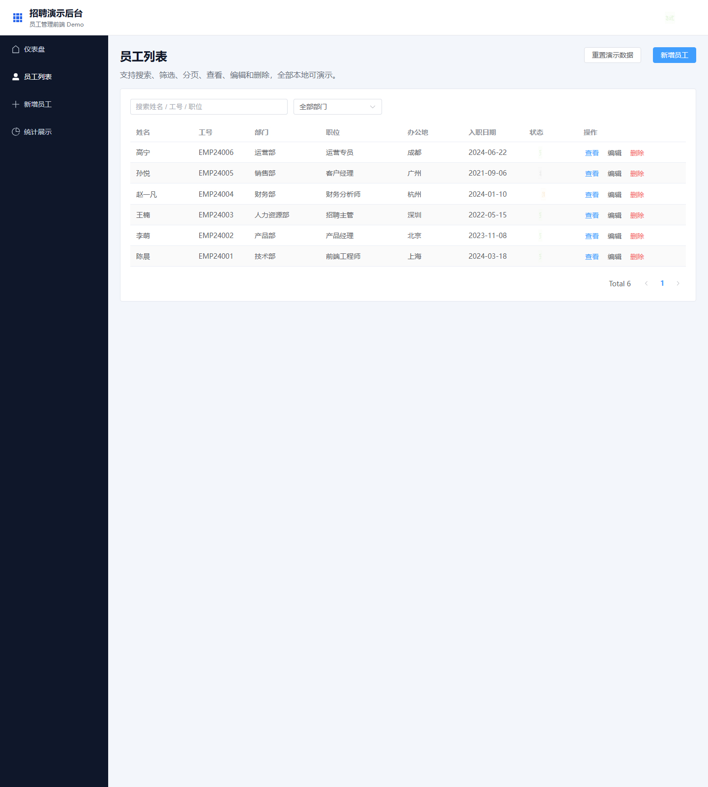
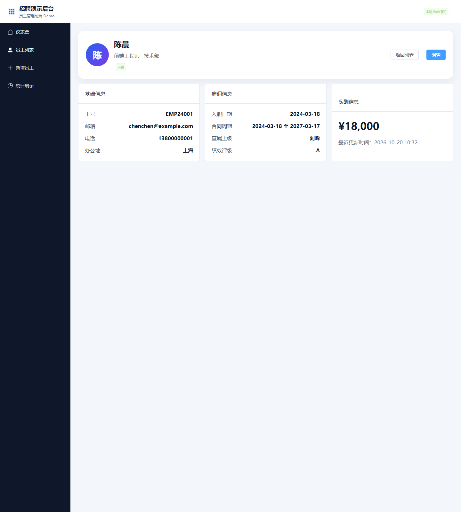
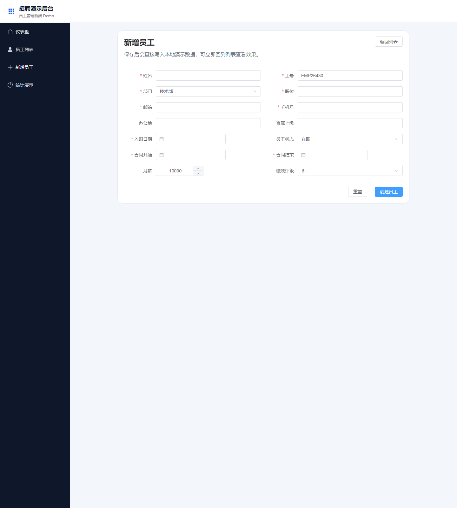

# 飞书员工-薪酬-财务集成项目

一个面向招聘展示整理过的业务项目仓库。项目背景基于飞书开放平台，主题是员工管理、薪酬审批和财务协同；公开仓库中为了保证可读性与可演示性，前端默认以 **Mock Mode** 运行，不强依赖飞书密钥、数据库和回调环境。

## 项目背景

这个项目原始设想是做一套围绕飞书开放平台的企业内部系统集成方案，目标包括：

- 以员工管理为入口，统一组织、人员、状态信息
- 通过飞书通讯录、审批、考勤等能力打通 HR 流程
- 将薪酬与财务流程纳入同一套业务链路

公开仓库保留了这个业务背景，因此你会看到后端中存在飞书相关配置、SDK 引用和组织同步逻辑；但出于安全和演示稳定性考虑，当前仓库默认展示的是前端的 **Mock Mode** 版本。

## 架构



当前仓库可以理解为三段式结构：

- `frontend`
  - Vue 3 + Vite 的招聘演示前端
  - 已改造成不依赖外部系统即可查看的 Mock Mode
- `backend`
  - Spring Boot 主后端
  - 负责员工、审批、飞书集成等业务草稿
- `finance-service`
  - Node.js / Express 财务服务雏形
  - 主要承接报销、预算、对账、报表等路由方向

## 技术栈

### 前端

- Vue 3
- Vite
- Vue Router
- Element Plus

### 后端

- Spring Boot 3
- MyBatis / MyBatis Plus
- MySQL
- Redis

### 其他

- Node.js + Express（财务服务）
- 飞书开放平台 / Lark Open Platform

## Mock Mode 说明

### 为什么这样处理

如果公开仓库完全依赖真实飞书环境，招聘者在查看项目时通常会遇到下面这些问题：

- 需要飞书应用 `app_id / app_secret`
- 需要数据库、Redis、审批模板、权限范围
- 需要事件回调、组织数据和网络环境

这会让仓库可读性明显下降。所以当前仓库采用的策略是：

- **项目背景保留飞书业务语境**
- **公开演示前端切换为 Mock Mode**

也就是说，招聘者不需要配置外部服务，也能快速看到页面结构、交互流转和前端工程组织方式。

### Mock Mode 包含什么

当前前端已经支持：

- 仪表盘统计展示
- 员工列表
- 搜索与部门筛选
- 员工详情页
- 新增 / 编辑员工
- 本地模拟数据增删改查

本地数据文件位于：

- [frontend/src/mock/employeeStore.js](frontend/src/mock/employeeStore.js)

## 功能截图

### 1. 仪表盘



### 2. 员工列表



### 3. 员工详情



### 4. 新增员工



## 演示说明

### 前端演示

```bash
cd frontend
npm install
npm run dev
```

默认访问：

```text
http://127.0.0.1:5173
```

说明：

- 当前前端不依赖后端接口
- 所有页面数据均来自本地 Mock Store
- 适合招聘者快速浏览页面与代码结构

### 后端状态

后端目前更适合用来展示业务方向和集成意图，而不是直接作为完整可运行交付物。当前仓库中仍存在一些未完全补齐的 DTO、Mapper 和运行时依赖，因此我在公开仓库里把前端演示能力优先整理出来了。

## 飞书集成说明

这个仓库依然保留飞书相关业务语义，原因是它本来就是一个飞书集成方向的业务项目。

后端中可见的飞书相关内容包括：

- 飞书客户端配置
- 组织架构同步思路
- 通讯录 / 考勤 / 审批相关接口草稿

但公开仓库默认 **不直接启用真实飞书交互**，原因如下：

- 避免公开仓库携带真实凭证
- 避免招聘者必须具备飞书开发环境才能理解项目
- 提高代码阅读与页面浏览的直达性

因此更准确的理解是：

- **业务背景：飞书项目**
- **公开展示方式：Mock Mode**

## 目录结构

```text
.
├─ frontend/              # Vue 3 前端演示项目（当前主要展示入口）
├─ backend/               # Spring Boot 主后端
├─ finance-service/       # Node.js 财务服务草稿
├─ docs/
│  └─ screenshots/        # README 使用的页面截图
└─ PROJECT_STRUCTURE.md   # 更详细的项目结构说明
```

更详细的结构说明可以查看：

- [PROJECT_STRUCTURE.md](PROJECT_STRUCTURE.md)

## 我在这个仓库里重点整理了什么

- 将前端改造成可独立查看的 Mock Mode
- 补齐员工列表、详情、表单、仪表盘页面流转
- 移除公开仓库里对真实飞书运行环境的强依赖
- 补充截图与项目说明，方便招聘者快速理解项目

## 后续可以继续完善的方向

- 给 `frontend` 增加登录页、部门页、报表页
- 补全 `backend` 缺失的 DTO / Mapper / 运行依赖
- 把飞书接口抽象成可切换的 `mock / real` 模式
- 增加接口文档和更完整的测试说明
